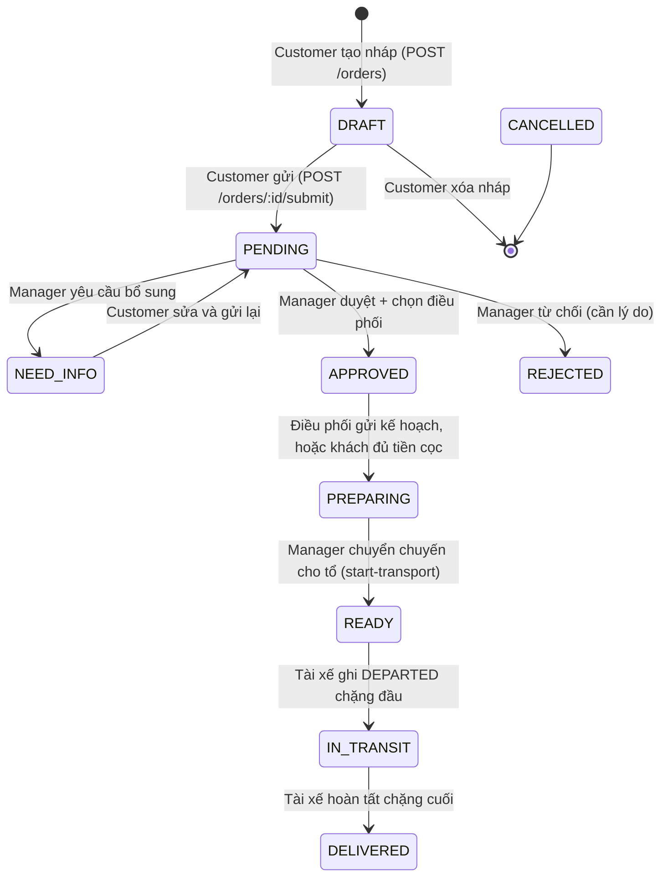
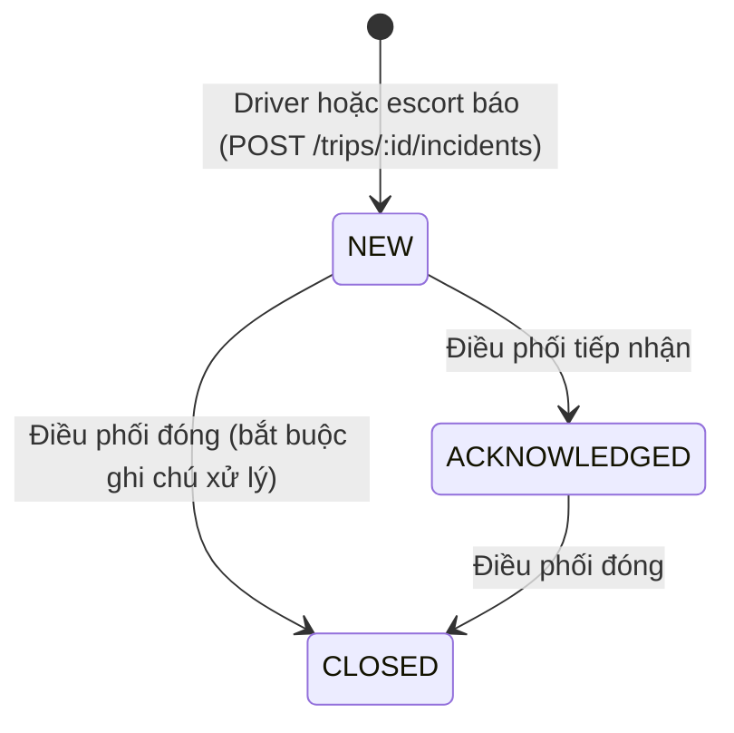
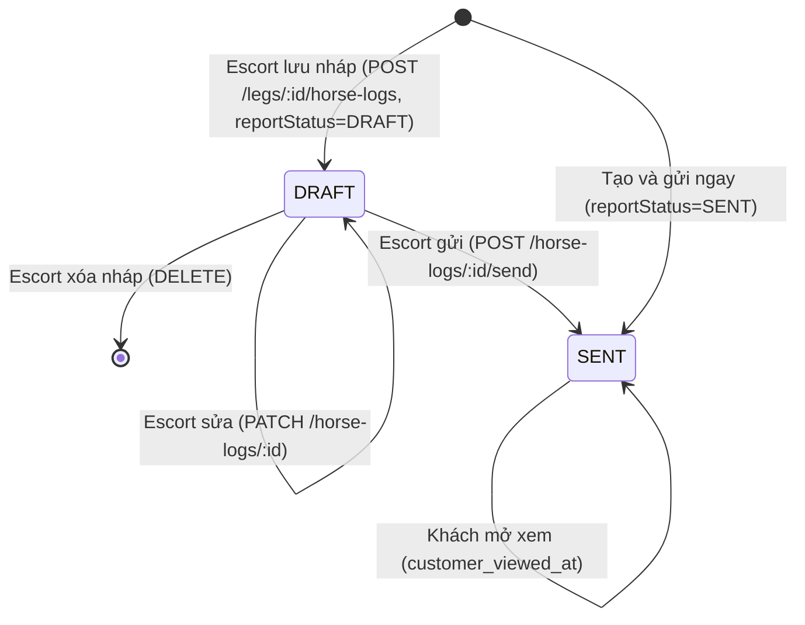

# 01 — Kiểm kê dữ liệu cho mobile MVP

Ngày lập: 29/10/2026. Đọc từ repo trên máy Long (bản mới nhất), chỉ đọc, không sửa code. Mọi đường dẫn tính từ gốc repo. Chỗ chưa chắc ghi **CẦN XÁC NHẬN**.

Kết luận nhanh: backend đã phục vụ gần đủ cả 3 actor. Driver và escort có API riêng, đầy đủ, kể cả gửi GPS theo lô. Mobile thiếu 4 thứ bắt buộc phía backend: lưu device token để gửi push, chống tạo trùng khi gửi lại từ hàng chờ offline, cách xử lý giới hạn nhập bù 120 phút khi mất mạng lâu, và quyết định về vị trí thật của xe cho customer (hiện customer chỉ thấy vị trí ước tính).

## 1. Cấu trúc repo

| Thành phần | Đường dẫn | Ghi chú |
| --- | --- | --- |
| Backend Express | `apps/api/src/app.ts`, `apps/api/src/index.ts` | README gốc ghi NestJS + Firebase là thông tin cũ |
| Route gốc `/api/v1` | `apps/api/src/routes/index.ts` | Mọi route sau `authenticate` đều cần JWT |
| Route, service, validation theo tính năng | `apps/api/src/features/<tên>/` | `tracking`, `trips`, `orders`, `customer`, `payments`, `documents`, `notifications`, `users`... |
| Schema MySQL gốc | `apps/api/test/fixtures/schema.sql` | Bản dump schema v2 (24 bảng), dùng cho test và seed demo |
| Migration bổ sung | `apps/api/src/database/migrations/18*.ts` | Thêm bảng/cột sau schema v2 |
| Enum, hằng số, type dùng chung | `packages/shared/src/` (`enums/`, `constants/`, `types/`) | Mobile có thể import thẳng |
| Realtime | `apps/api/src/shared/socket/socket.service.ts` | Socket.IO, xác thực bằng JWT, phòng `user:<id>`, `role:<role>`, `order:<id>` |
| Lớp gọi API của web | `apps/web/src/features/tracking/tracking.api.ts`, `apps/web/src/modules/trips/api/trips.api.ts`, `apps/web/src/lib/axios.ts`, `apps/web/src/lib/socket.ts` | Mẫu để viết lớp API mobile |
| Dữ liệu mẫu | `database/wdp_seed_v2.sql`, `apps/api/scripts/seed-flow4-demo.cjs` | Seed demo tạo tài khoản đăng nhập được, mật khẩu `Demo@12345` |
| Tài liệu phân tích sẵn có | `docs/gap-analysis-driver.md`, `docs/gap-analysis-escort.md`, `docs/customer.md`, `docs/ke-hoach-flow4-tracking.md` | Mô tả màn D1/D2 (driver), E1/E2 (escort) đã làm trên web |

## 2. Vai trò và cách xác định actor

- Tài khoản có `users.role` ∈ `ADMIN, MANAGER, SPECIALIST, COORDINATOR, DRIVER_ESCORT, CUSTOMER` (`packages/shared/src/enums/role.enum.ts`).
- **Driver và escort dùng chung một role tài khoản `DRIVER_ESCORT`.** Vai trò trên từng chuyến nằm ở `trip_assignments.role` ∈ `DRIVER, ESCORT` (`packages/shared/src/enums/order.enum.ts`, `CrewRole`). Hồ sơ nhân sự `crew_profiles.crew_type` (`DRIVER`/`ESCORT`) và `work_status` (`AVAILABLE`/`IN_TRIP`) (`apps/api/test/fixtures/schema.sql`).
- Hệ quả cho mobile: sau đăng nhập, `role = CUSTOMER` → giao diện customer; `role = DRIVER_ESCORT` → giao diện nhân sự, rồi theo `crewRole` của từng chuyến (`IDriverTripSummary.crewRole`) mà hiện màn driver hoặc escort. Một người có thể là tài xế chuyến này, hộ tống chuyến khác (**CẦN XÁC NHẬN** thực tế có xảy ra không; `checkCrewReadiness` trong `apps/api/src/features/trips/trips.crew.ts` bắt `crew_type` khớp `role`, nên trên thực tế mỗi người cố định một loại).
- Role khác (`MANAGER`, `COORDINATOR`...) đăng nhập mobile: hiện màn "Ứng dụng dành cho khách hàng và tổ vận chuyển".

## 3. Xác thực

- `POST /auth/login` {email, password} → `{accessToken, user}`; `POST /auth/register` chỉ tạo `CUSTOMER` (`apps/api/src/features/auth/auth.service.ts`).
- JWT HS256, hạn **7 ngày**, không có refresh token, không có endpoint đăng xuất (`apps/api/src/shared/utils/jwt.util.ts`).
- Header `Authorization: Bearer <token>`; tài khoản không `ACTIVE` bị chặn 403 (`apps/api/src/shared/middlewares/auth.middleware.ts`).
- Socket.IO nhận token qua `handshake.auth.token` (`socket.service.ts`).
- Không có quên mật khẩu qua email. Có `POST /users/me/password` (đổi mật khẩu khi đã đăng nhập, giới hạn 10 lần/15 phút).

## 4. Thực thể dữ liệu

Nguồn mặc định: `apps/api/test/fixtures/schema.sql`; cột thêm sau ghi migration. Chỉ liệt kê trường mobile cần. Thời gian lưu UTC.

### 4.1 Người dùng — `users`

| Trường | Kiểu | Bắt buộc | Ý nghĩa | Ví dụ |
| --- | --- | --- | --- | --- |
| id | bigint | có | | `7` |
| email | varchar(100) | có | đăng nhập | `chu.ngua@example.com` |
| full_name | varchar(100) | có | | `Nguyễn Minh Anh` |
| phone | varchar(20) | không | | `0903 123 456` |
| role | enum | có | xem mục 2 | `CUSTOMER` |
| account_status | enum ACTIVE/LOCKED/PENDING | có | | `ACTIVE` |
| customer_type | enum CLUB/INDIVIDUAL | không | khách là CLB hay cá nhân | `CLUB` |
| organization_name | varchar(150) | không | tên CLB | `CLB Đua ngựa Phú Thọ` |
| address | varchar(255) | không | | `Q.11, TP.HCM` |
| ảnh đại diện | `account_avatars.image` (mediumtext) | không | migration `1800000090000-AccountAvatars.ts` | |

### 4.2 Hồ sơ ngựa của khách — `customer_horse_profiles` (migration `1800000009000-CustomerProfiles.ts`)

Đây là "hồ sơ ngựa" của chủ ngựa, độc lập với đơn. Ngựa trong đơn (`horses`) là bản chụp tại thời điểm gửi đơn.

| Trường | Kiểu | Bắt buộc | Ý nghĩa | Ví dụ |
| --- | --- | --- | --- | --- |
| id, owner_id | bigint | có | | |
| name | varchar(100) | có | tên ngựa | `Sao Mai` |
| passport_no | varchar(50), unique | không | số hộ chiếu ngựa | `VN-HP-2021-0012` |
| payload.breed | ≤50 | không | giống | `Thoroughbred` |
| payload.birthDate | date | không | | `12/03/2021` |
| payload.sex | `''`/`Đực`/`Cái` | không | | `Cái` |
| payload.coatColor | ≤30 | không | màu lông | `Nâu` |
| payload.microchip | ≤50 | không | | `985 112 004 567 321` |
| payload.weightKg / heightCm | số | không | | `480` / `162` |
| payload.ownerName, feed, note, documentNote | text | không | | |
| revision | int | có | khóa lạc quan khi sửa | `3` |
| ảnh/giấy tờ | `customer_profile_files` kind PHOTO/DOCUMENT, slot | không | ảnh ngựa và giấy tờ gắn sẵn | |

Nguồn validation: `apps/api/src/features/customer/customer.validation.ts` (`profileSchema`).

### 4.3 Đơn vận chuyển — `orders`

| Trường | Kiểu | Bắt buộc | Ý nghĩa | Ví dụ |
| --- | --- | --- | --- | --- |
| order_code | varchar(20) | có | mã đơn (`order-code.ts`) | `HR-2610-0012` (**CẦN XÁC NHẬN** định dạng thật) |
| status | enum 10 trạng thái | có | mục 5.1 | `IN_TRANSIT` |
| origin_address / origin_country | text / char(2) | khi gửi | điểm đi | `Mộc Bài, Tây Ninh` / `VN` |
| destination_address / destination_country | | khi gửi | điểm đến | `Svay Rieng` / `KH` |
| desired_departure_date | date | khi gửi | ngày muốn đi | `05/11/2026` |
| special_requirements | text ≤5000 | không | yêu cầu đặc biệt | |
| booking_details | json | không | người gửi/nhận, hạng xe, bảo hiểm, thức ăn, nước... (`bookingSchema`) | |
| recipient_name / recipient_phone | varchar | không | người nhận tại điểm đến (migration `...7000-DriverIncidentDetails.ts`) | `Trần Văn Bình` |
| manager_note | text | không | lý do từ chối / cần bổ sung | |
| draft_payload, client_request_id | json, uuid | không | nháp và chống tạo trùng khi gửi lại | |
| requirements_snapshot | json | không | giấy tờ bắt buộc chụp lúc duyệt | |

Ngựa trong đơn — `horses`: name, passport_no, breed, birth_date, sex, coat_color, note, `order_status` ∈ `NORMAL/FLAGGED/REMOVED` (ngựa bị đánh dấu chặn xuất phát).

### 4.4 Báo giá và thanh toán (mobile chỉ xem)

- `order_quotes` (migration `1800000008000-ManagerQuotes.ts`): status `DRAFT/APPROVED/NEED_REVISION`; khách chỉ thấy bản `APPROVED` mới nhất qua `GET /orders/:id/quote`: `items`, `adjustment`, `adjustment_reason`, `vat_percent`, `vat_amount`, `total`, `deposit`, `deposit_percent`, `expires_at`, `paid`, `receipts[]` (`apps/api/src/features/orders/orders.service.ts`, hàm `quote`).
- `payment_sessions`: type `DEPOSIT/BALANCE`, method `BANK_TRANSFER/E_WALLET/CARD`, status `PENDING/SUCCESS/FAILED/CANCELLED` (migration `1800000012000`).
- `order_receipts`: amount, method, source, reference, received_at.
- Ví dụ: tổng `48.600.000 ₫`, cọc 30% `14.580.000 ₫` (đề xuất, không lấy từ seed).

### 4.5 Giấy tờ (mobile chỉ xem trạng thái)

- `documents`: mỗi ngựa 3 loại bắt buộc (`required-horse-documents.ts`), status `NOT_SUBMITTED/SUBMITTED/VALID/INVALID/EXPIRED`, `expiry_date`, `invalid_reason`.
- `GET /orders/customer-workspace` đã trả sẵn `missing_documents`, `pending_documents` theo ngựa.

### 4.6 Chuyến, chặng, mốc

| Bảng | Trường chính | Nguồn |
| --- | --- | --- |
| `trips` | order_id, plan_status (`DRAFT/PENDING_APPROVAL/APPROVED`), planned_departure_at, planned_arrival_at, planned_by (điều phối), route_plan | schema.sql, migration `...13000-TripRoutePlan.ts` |
| `legs` | seq_no, from/to_location_id (nullable khi dùng route_plan), vehicle_id, planned_departure_at, planned_arrival_at, status (`NOT_STARTED/MOVING/AT_STOP/COMPLETED`), actual_departure_at, actual_arrival_at | schema.sql, migration `...16000` |
| `leg_milestones` | milestone_type (`DEPARTED/ARRIVED_AT_STOP/CUSTOMS_CLEARED/DELIVERED`), occurred_at, recorded_by | schema.sql |
| `trip_assignments` | user_id, role (`DRIVER/ESCORT`), trip_vehicle_id | schema.sql, migration `...15000-TripFleet.ts` |
| `trip_vehicles`, `vehicles` | horse_count; vehicle_type (`LIGHT/MEDIUM/HEAVY`), capacity_stalls, license_plate | migration `...15000`, schema.sql |
| `locations` | name, location_type (`BORDER/QUARANTINE_STATION/REST_STOP/AIRPORT/FUEL_STOP`), country, timezone, latitude, longitude | schema.sql, migration `...5000` |

Mobile nhận qua type dùng chung `IDriverTripSummary`, `IDriverTripDetail` (crew, customer, recipient, coordinator, emergencyHotline, vehicles, horses, legs), `ILegTracking`, `IOrderTimeline` (`packages/shared/src/types/tracking.type.ts`).

Lưu ý: migration `...16000` ghi "legs chỉ còn một bản ghi vận hành đại diện" cho chuyến mới, lộ trình chi tiết nằm ở `trips.route_plan`. Màn driver hiện hiển thị điểm dừng theo route plan (`StopTimeline.tsx`). **CẦN XÁC NHẬN**: chuyến mới có luôn đúng 1 leg không, để thiết kế nút "Đã đến điểm dừng" theo điểm dừng hay theo chặng.

### 4.7 GPS — `trip_positions` (migration `1800000006000-TrackMap.ts`)

latitude, longitude, accuracy_m, speed_mps, heading_deg, recorded_at (giờ thiết bị), received_at. Khóa duy nhất (trip_id, user_id, recorded_at) nên gửi lại một lô **không tạo trùng**. Tự xóa sau `TRACK_POSITION_RETENTION_DAYS` (mặc định 30 ngày).

### 4.8 Sự cố — `incidents`

| Trường | Kiểu | Bắt buộc | Ví dụ |
| --- | --- | --- | --- |
| incident_type | `VEHICLE_BREAKDOWN/LONG_TRAFFIC_JAM/HORSE_MEDICAL` | có | `HORSE_MEDICAL` |
| sub_type | code trong `INCIDENT_SUB_TYPES` | không | `COLIC` (Đau bụng) |
| severity | `RED/ORANGE/YELLOW` (Nghiêm trọng/Trung bình/Nhẹ) | có | `ORANGE` |
| urgency | `NORMAL/HIGH` (RED → HIGH) | tự suy | |
| damage_target | `VEHICLE/HORSE/BOTH` | có | `HORSE` |
| horse_id | | bắt buộc nếu HORSE_MEDICAL | `Sao Mai` |
| description | 5–2000 ký tự | có | `Ngựa cào chân, đổ mồ hôi sau trạm nghỉ` |
| latitude/longitude, location_text | | không | `QL22, gần Gò Dầu` |
| ảnh | ≤3 ảnh, mỗi ảnh có caption ≤100 | không | |
| status | `NEW/ACKNOWLEDGED/CLOSED` + received_by, handling_note | do điều phối đổi | |

Nguồn: `apps/api/src/features/tracking/tracking.validation.ts` (`createIncidentSchema`), `packages/shared/src/constants/incident.constants.ts`.

### 4.9 Nhật ký sức khỏe ngựa — `horse_logs` (schema.sql + migration `1800000013000-EscortHorseCare.ts`)

| Trường | Kiểu | Bắt buộc | Ví dụ |
| --- | --- | --- | --- |
| horse_id, leg_id | | có | |
| condition_status | `STABLE/OFF_FEED/STRESSED/CLIMATE_CHANGE` (Sức khỏe ổn định/Bỏ ăn/Căng thẳng/Khí hậu thay đổi) | có | `STRESSED` |
| body_temp_c | 30.0–45.0, 1 số lẻ | không | `38,2` |
| heart_rate_bpm | 10–200 | không | `44` |
| appetite | `NORMAL/REDUCED/REFUSED` | không | `REDUCED` |
| note (nội bộ), customer_note (gửi khách) | ≤1000 | không | |
| report_status | `DRAFT/SENT`; NULL = nhật ký cũ | | `DRAFT` |
| send_to_customer, sent_at, customer_viewed_at | | | |
| ảnh | ≤3; **bắt buộc ≥1 ảnh khi gửi** nếu trạng thái không phải STABLE | | |
| corrects_log_id | đính chính bản ghi cũ (chỉ thêm, không sửa) | | |

Nguồn: `packages/shared/src/constants/horse.constants.ts`.

### 4.10 Hoạt động chăm sóc — `horse_care_activities` (migration `1800000013000`)

| Trường | Ràng buộc | Ví dụ |
| --- | --- | --- |
| activity_type | `FEED/WATER/REST` (Cho ăn/Uống nước/Nghỉ chân) | `WATER` |
| horse_id | bắt buộc trừ REST (REST có thể cho cả đoàn) | |
| feed_description | chỉ FEED, 1–200 ký tự | `3 kg cỏ khô + 1 kg yến mạch` |
| amount_liters | chỉ WATER, 0,1–200 | `12` |
| duration_minutes | chỉ REST, 1–720 | `30` |
| note | ≤255 | |
| performed_at | không ở tương lai, nhập bù tối đa 120 phút | |
| corrects_activity_id | đính chính | |

`GET /tracking/trips/:tripId/care-activities` trả thêm `summary` (tổng nước, số bữa, số lần nghỉ, giờ cho ăn gần nhất theo ngựa).

### 4.11 Ảnh/tệp — `attachments`

original_name, file_type `PDF/JPG/PNG` (kiểm tra bằng magic bytes), size ≤ **5 MB**, caption, liên kết horse_log_id / incident_id. Không nhận HEIC (`apps/api/src/features/documents/file-storage.ts`). Mobile phải chuyển ảnh camera sang JPEG và nén trước khi gửi.

### 4.12 Cảnh báo và thông báo

- `alerts`: TRAFFIC/WEATHER/BORDER, content, do điều phối gửi cho tổ trên chuyến (socket `tracking:alert`).
- `notifications`: event_type, content (≤500), related_type (`ORDER/TRIP/DOCUMENT`), related_id, channel `IN_APP/EMAIL/SMS`, is_read, created_at.

## 5. Trạng thái nghiệp vụ

### 5.1 Đơn hàng (`orders.status`)



Nguồn: `orders.service.ts` (`submit`, `review`, `editable = DRAFT, NEED_INFO`), `trips.repository.ts` (`submitPlan`, `markOrderReady`), `payments.service.ts` (cọc → PREPARING), `tracking.service.ts` (xuất phát → IN_TRANSIT, hoàn tất → DELIVERED). **CẦN XÁC NHẬN**: không tìm thấy đoạn code nào chuyển sang `CANCELLED`; customer không có API hủy đơn.

### 5.2 Chặng (`legs.status`) — chỉ tài xế của chuyến được đổi

```mermaid
stateDiagram-v2
  [*] --> NOT_STARTED
  NOT_STARTED --> MOVING: Driver ghi DEPARTED (kế hoạch APPROVED; chặng đầu cần đơn READY, không còn blocker)
  MOVING --> AT_STOP: Driver ghi ARRIVED_AT_STOP
  AT_STOP --> MOVING: Driver ghi DEPARTED tiếp
  AT_STOP --> COMPLETED: Driver hoàn tất chặng (cửa khẩu cần CUSTOMS_CLEARED trước)
  MOVING --> COMPLETED: Driver hoàn tất
  COMPLETED --> [*]
  note right of COMPLETED: Điều phối/Manager hiệu chỉnh được mọi trạng thái (PATCH /legs/:id/correct)
```

Nguồn: `tracking.service.ts` (`DRIVER_ONLY`, `recordMilestone`, `completeLeg`), `tracking.validation.ts`. Escort gọi các API này nhận 403. **CẦN XÁC NHẬN** chi tiết chuyển AT_STOP → MOVING.

### 5.3 Sự cố (`incidents.status`)



Người báo nhận socket `tracking:incident_updated` khi trạng thái đổi.

### 5.4 Báo cáo sức khỏe ngựa (`horse_logs.report_status`) — escort tạo



Khi gửi: trạng thái khác STABLE → thông báo `HORSE_REPORT_ALERT` cho điều phối; nếu `sendToCustomer` → `HORSE_REPORT` cho khách (`tracking.service.ts` dòng ~810–840).

### 5.5 Trạng thái khác

- Kế hoạch chuyến `trips.plan_status`: DRAFT → PENDING_APPROVAL → APPROVED (điều phối và manager; mobile chỉ đọc).
- Giấy tờ: NOT_SUBMITTED → SUBMITTED → VALID / INVALID; VALID → EXPIRED khi quá hạn.
- Phiên thanh toán: PENDING → SUCCESS / FAILED / CANCELLED.
- Ngựa trong đơn: NORMAL / FLAGGED (chặn xuất phát) / REMOVED.

## 6. API cho 3 actor

Tiền tố `/api/v1`. Tất cả cần JWT trừ `auth`. "Quyền" = role tài khoản; quyền theo chuyến kiểm thêm trong service.

### 6.1 Chung

| Method | Path | Quyền | Input | Output chính | Phân trang | Nguồn |
| --- | --- | --- | --- | --- | --- | --- |
| POST | /auth/login | công khai | email, password | accessToken, user | | `features/auth/auth.routes.ts` |
| POST | /auth/register | công khai | email, password, fullName, phone, address, customerType, organizationName | như login | | như trên |
| GET | /users/me | mọi role | | IUser | | `features/users/users.routes.ts` |
| PATCH | /users/me | mọi role | hồ sơ | | | như trên |
| GET/POST | /users/me/avatar | mọi role | ảnh ≤5 MB | | | như trên |
| POST | /users/me/password | mọi role | mật khẩu cũ/mới | | | như trên |
| GET | /notifications | mọi role | | 100 thông báo mới nhất | không | `features/notifications/` |
| POST | /notifications/:id/read | mọi role | | | | như trên |
| Socket | `notification:new`, `order:status_updated`, `payment:updated`, `tracking:*` | | `join:order` | | | `shared/socket/socket.service.ts` |

### 6.2 Customer

| Method | Path | Input | Output chính | Nguồn |
| --- | --- | --- | --- | --- |
| GET | /customer/profiles | | danh sách hồ sơ ngựa | `features/customer/customer.routes.ts` |
| POST / PUT | /customer/profiles(/:id) | profileSchema (kèm revision khi sửa) | hồ sơ | như trên |
| POST | /customer/profiles/:id/files | multipart, kind PHOTO/DOCUMENT, slot | | như trên |
| GET | /customer/files/:id | | ảnh/PDF | như trên |
| POST | /customer/route-distance | điểm đi/đến | km ước tính | như trên |
| GET | /orders/customer-workspace | | orders (kèm số ngựa, tên ngựa, quote_total, paid), horses (kèm giấy tờ thiếu), receipts | `features/orders/orders.routes.ts` |
| GET | /orders, /orders/:id | page, limit, status, group | danh sách / chi tiết | như trên (có phân trang) |
| POST / PUT / DELETE | /orders(/:id) | draftOrderSchema (requestId uuid chống trùng) | nháp | `orders.validation.ts` |
| POST | /orders/:id/submit | | status PENDING | như trên |
| GET | /orders/:id/quote | | báo giá APPROVED + receipts | như trên |
| GET | /payments/orders/:id | | lịch sử thanh toán | `features/payments/payments.routes.ts` |
| GET | /documents/orders/:orderId | | giấy tờ theo ngựa | `features/documents/documents.routes.ts` |
| GET | /tracking/orders/:orderId/timeline | | IOrderTimeline | `features/tracking/tracking.routes.ts` |
| GET | /tracking/orders/:orderId/map | | bản đồ, vị trí **ước tính** | như trên |
| GET | /tracking/orders/:orderId/horse-reports | | IHorseReport[] đã gửi | như trên |
| POST | /tracking/orders/:orderId/horse-reports/:id/view | | đánh dấu đã xem | như trên |
| GET | /tracking/orders/:orderId/care-activities | | nhật ký chăm sóc | như trên |
| GET | /tracking/attachments/:id | | ảnh | như trên |

### 6.3 Driver và escort (role `DRIVER_ESCORT`)

| Method | Path | Crew | Input | Output | Nguồn |
| --- | --- | --- | --- | --- | --- |
| GET | /tracking/driver/trips | cả hai | | IDriverTripSummary[] (kèm crewRole, legs) | `tracking.routes.ts` |
| GET | /tracking/trips/:id | cả hai | | IDriverTripDetail | như trên |
| POST | /tracking/legs/:legId/milestones | DRIVER | milestoneType, occurredAt (UTC, ≤120 phút trước) | chặng sau cập nhật | `tracking.validation.ts` |
| POST | /tracking/legs/:legId/complete | DRIVER | occurredAt | | như trên |
| POST | /tracking/trips/:tripId/positions | DRIVER | points[1..20] {lat, lng, recordedAt, accuracyM?, speedMps?, headingDeg?}; chỉ khi IN_TRANSIT; ≤30 lần/phút; điểm ≤24 giờ | accepted, duplicates | như trên |
| GET | /tracking/trips/:tripId/map, /positions | cả hai | since | bản đồ, vệt đường | như trên |
| POST | /tracking/trips/:tripId/incidents | cả hai | multipart: createIncidentSchema + photos ≤3 | IIncident | như trên |
| GET | /tracking/trips/:tripId/incidents | cả hai | | IIncident[] | như trên |
| GET | /tracking/trips/:tripId/alerts | cả hai | | IAlert[] | như trên |
| POST | /tracking/legs/:legId/horse-logs | ESCORT (**CẦN XÁC NHẬN** driver có được không) | multipart: horseId, conditionStatus, loggedAt, reportStatus, vitals, photos ≤3 | IHorseLog | như trên |
| PATCH / DELETE | /tracking/horse-logs/:id | người tạo | sửa / xóa nháp | | như trên |
| POST | /tracking/horse-logs/:id/send | người tạo | sendToCustomer | | như trên |
| GET | /tracking/trips/:tripId/horse-logs | cả hai | | IHorseLog[] | như trên |
| POST / GET | /tracking/trips/:tripId/care-activities | ghi: ESCORT; đọc: cả hai | ICareActivityCreateInput | ICareActivityList | như trên |
| GET | /tracking/trips/:tripId/timeline | cả hai | | ITripTimeline | như trên |

Không endpoint nào có phân trang ngoài `/orders`. Không endpoint nào hỗ trợ `updatedSince` để đồng bộ phần thay đổi.

## 7. Phân quyền theo actor

| Dữ liệu | Customer | Driver | Escort |
| --- | --- | --- | --- |
| Hồ sơ ngựa của mình | xem, tạo, sửa (không có xóa) | | |
| Đơn, báo giá, thanh toán, giấy tờ của mình | xem; tạo/sửa/gửi khi DRAFT/NEED_INFO | | |
| Chuyến được phân công, chặng, ngựa trên chuyến, liên hệ | | xem | xem |
| Ghi mốc, hoàn tất chặng, gửi GPS | | có | không (403) |
| Báo sự cố | | có | có |
| Nhật ký chăm sóc, báo cáo sức khỏe | xem bản đã gửi cho mình | xem | ghi, sửa nháp, gửi |
| Cảnh báo từ điều phối | | nhận | nhận |
| Vị trí xe | chỉ vị trí ước tính theo mốc | thật | thật |

## 8. Ánh xạ chức năng MVP → dữ liệu

| Actor | Chức năng | Hiển thị | Nhập | Endpoint | Trạng thái liên quan | Mức sẵn sàng |
| --- | --- | --- | --- | --- | --- | --- |
| Customer | Hồ sơ ngựa | tên, giống, tuổi, giới tính, màu lông, microchip, ảnh, giấy tờ | các trường profileSchema, ảnh | /customer/profiles, /files | | Thiếu một phần: không có xóa hồ sơ |
| Customer | Gửi yêu cầu vận chuyển đơn giản | | điểm đi/đến, ngày, chọn ngựa từ hồ sơ, yêu cầu đặc biệt (booking tùy chọn) | POST/PUT /orders, /submit | DRAFT → PENDING | Đủ |
| Customer | Xem đơn và báo giá | trạng thái, ngựa, giấy tờ thiếu, tổng, cọc, đã trả, hạn báo giá | | /orders/customer-workspace, /orders/:id, /quote, /payments/orders/:id | 10 trạng thái đơn | Thiếu một phần: không có API chấp nhận/từ chối báo giá; chấp nhận thực chất là đặt cọc (làm trên web) |
| Customer | Theo dõi vị trí | timeline chặng, bản đồ, vị trí, báo cáo sức khỏe, nhật ký chăm sóc | | /timeline, /map, /horse-reports, /care-activities | READY, IN_TRANSIT, DELIVERED | Thiếu một phần: vị trí chỉ ước tính theo mốc |
| Customer | Nhận thông báo | danh sách, chưa đọc | | /notifications, socket | | Thiếu một phần: chưa có push |
| Driver | Xem chuyến được giao | mã đơn, giờ, chặng, ngựa, xe, người nhận, điều phối, hotline | | /driver/trips, /trips/:id | plan APPROVED, đơn READY | Đủ |
| Driver | Checklist trước chuyến | 5 mục cố định (`driver-ui.ts`) | tick | không có | | Chưa có backend (web lưu ở máy, `gap-analysis-driver.md` mục 5.3) |
| Driver | Cập nhật mốc chặng | điểm dừng, giờ kế hoạch/thực tế | loại mốc, giờ | /milestones, /complete | Leg, Order | Đủ, nhưng giới hạn nhập bù 120 phút |
| Driver | GPS nền | trạng thái chia sẻ | tự động | /positions | IN_TRANSIT | Đủ (lô 20 điểm, chống trùng) |
| Driver | Báo sự cố kèm ảnh | | loại, loại con, mức độ, hư hại, ngựa, mô tả, vị trí, ≤3 ảnh | POST /incidents | NEW | Thiếu một phần: gửi lại từ hàng chờ có thể tạo trùng |
| Escort | Danh sách ngựa | tên, hộ chiếu, giống, ngày sinh, báo cáo gần nhất, giờ cho ăn gần nhất | | /trips/:id, /horse-logs, /care-activities | | Thiếu một phần: không có ảnh ngựa |
| Escort | Nhật ký chăm sóc/sức khỏe | | loại hoạt động, lượng, tình trạng, nhiệt độ, nhịp tim, ăn uống, ghi chú | /care-activities, /horse-logs | DRAFT/SENT | Đủ, giới hạn nhập bù 120 phút cho chăm sóc |
| Escort | Chụp ảnh | | ≤3 ảnh/báo cáo | multipart | | Đủ (JPG/PNG ≤5 MB) |
| Escort | Báo bất thường | | báo cáo trạng thái khác STABLE, hoặc sự cố HORSE_MEDICAL | /horse-logs/:id/send, /incidents | | Đủ |

## 9. Khoảng trống dữ liệu cho mobile

| # | Khoảng trống | Mức | Đề xuất thay đổi API (chỉ đề xuất) |
| --- | --- | --- | --- |
| G1 | Không có nơi lưu device token, không gửi push | Bắt buộc MVP | Bảng `user_devices(user_id, token, platform, updated_at)`; `POST/DELETE /users/me/devices`; khi ghi `notifications` thì gửi FCM kèm `related_type/related_id` để mở đúng màn |
| G2 | Gửi lại sự cố, báo cáo sức khỏe, hoạt động chăm sóc từ hàng chờ có thể tạo bản ghi trùng | Bắt buộc MVP | Thêm `clientRequestId` (uuid tạo trên máy) + khóa duy nhất, giống `orders.client_request_id` đã có |
| G3 | Mốc chặng và chăm sóc chỉ cho nhập bù 120 phút (`LEG_BACK`); mất mạng lâu hơn sẽ bị từ chối | Bắt buộc MVP (cần quyết định) | Phương án A: nhận mốc gửi từ hàng chờ với `queuedAt` và cửa sổ dài hơn (VD 24 giờ, giống GPS). Phương án B: giữ 120 phút, app báo "Cần điều phối hiệu chỉnh" và gọi hotline |
| G4 | Customer chỉ thấy vị trí ước tính (điểm xuất phát chặng), không thấy xe thật | Cần quyết định | Hoặc giữ như hiện tại (riêng tư tài xế), hoặc trả vị trí thật làm tròn và trễ 5–10 phút |
| G5 | Không có refresh token; JWT 7 ngày hết hạn giữa chuyến dài | Nên có | `POST /auth/refresh` + refresh token lưu Keychain; hoặc tăng hạn cho DRIVER_ESCORT |
| G6 | Checklist trước chuyến không lưu backend | Nên có | `GET/PUT /tracking/trips/:id/pre-departure-checks` (đã ghi trong `gap-analysis-driver.md`) |
| G7 | Không có API đồng bộ phần thay đổi | Nên có | `?updatedSince=` cho /driver/trips, /horse-logs, /care-activities, /notifications |
| G8 | Thông báo: không phân trang, không "đánh dấu tất cả đã đọc", không đếm chưa đọc | Nên có | `GET /notifications?cursor=`, `POST /notifications/read-all`, `unreadCount` |
| G9 | Customer không hủy đơn, không từ chối báo giá, không xóa hồ sơ ngựa | Nên có | `POST /orders/:id/cancel` (trước READY), `DELETE /customer/profiles/:id` |
| G10 | `ITripHorse` không có ảnh ngựa cho thẻ ngựa của escort | Nên có | Thêm `photoId` từ `customer_profile_files` (kind PHOTO) |
| G11 | Ảnh chỉ nhận JPG/PNG ≤5 MB | Xử lý ở app | App chuyển HEIC → JPEG, nén cạnh dài ~2000px, chất lượng 0,7 |
| G13 | Báo cáo sức khỏe chỉ bắt buộc ảnh khi tình trạng khác "Ổn định"; Long chốt mọi báo cáo sức khỏe đều phải có ảnh (29/10) | Bắt buộc MVP | Bỏ điều kiện `HORSE_REPORT_PHOTO_REQUIRED_STATUSES`, bắt buộc ≥1 ảnh cho mọi horse_log khi gửi (SENT) |
| G12 | Nhãn trạng thái trên web không thống nhất (DELIVERED: "Đã giao" / "Đã giao ngựa"; READY: "Sẵn sàng" / "Sẵn sàng vận chuyển"; DRAFT: "Nháp" / "Bản nháp") | Nên có | Đưa bảng nhãn vào `packages/shared` cho web và mobile dùng chung |

## 10. Dữ liệu lưu offline (SQLite)

| Actor | Bảng local | Trường | Chiều đồng bộ |
| --- | --- | --- | --- |
| Driver | trips | IDriverTripDetail (chặng, ngựa, xe, người nhận, điều phối, hotline) | tải về |
| Driver | pending_milestones | legId, milestoneType, occurredAt, trạng thái gửi, lỗi | gửi lên |
| Driver | pending_positions | lat, lng, recordedAt, accuracy, speed, heading | gửi lên (lô 20, bỏ điểm >24 giờ) |
| Driver | incident_drafts | toàn bộ form + đường dẫn ảnh local + clientRequestId | gửi lên |
| Driver | checklist | tripId, mục, đã tick, giờ | chỉ local (đến khi có G6) |
| Driver, escort | alerts, incidents | danh sách đã nhận | tải về |
| Escort | trip_horses | ITripHorse | tải về |
| Escort | care_activities | ICareActivity + bản chờ gửi | hai chiều (tải danh sách, gửi bản mới) |
| Escort | horse_reports | IHorseLog DRAFT/SENT + ảnh local | hai chiều (nháp có trên server, sửa được) |
| Customer | không cần SQLite | cache truy vấn (React Query persist) cho đơn, timeline | tải về |

Xung đột: các bảng nhật ký chỉ thêm mới, sửa bằng bản đính chính, nên ít xung đột. Rủi ro chính là trạng thái chặng do điều phối hiệu chỉnh trong lúc driver offline: khi gửi mốc nhận 409 thì tải lại chuyến và hỏi driver.

## 11. Thuật ngữ (theo web)

| Khái niệm | Từ dùng trên mobile | Nguồn web |
| --- | --- | --- |
| Customer | Khách hàng / Chủ ngựa (**CẦN XÁC NHẬN** từ nào trên UI) | |
| Driver / Escort | Tài xế / Người hộ tống ("hộ tống") | `trips.repository.ts` `notifyCrew` |
| Coordinator | Điều phối viên | `trip-error.ts`, `tracking.validation.ts` |
| Order / Trip / Leg | Đơn hàng / Chuyến / Chặng | `tracking.format.ts` |
| Đơn: DRAFT, PENDING, NEED_INFO, REJECTED, APPROVED, PREPARING, READY, IN_TRANSIT, DELIVERED, CANCELLED | Nháp, Chờ duyệt, Cần bổ sung, Từ chối, Đã duyệt, Đang chuẩn bị, Sẵn sàng vận chuyển, Đang vận chuyển, Đã giao, Đã hủy | `features/orders/types.ts`, `tracking.format.ts` |
| Chặng: NOT_STARTED, MOVING, AT_STOP, COMPLETED | Chưa bắt đầu, Đang di chuyển, Đang dừng, Hoàn thành | `driver-ui.ts`, `tracking.format.ts` |
| Mốc: DEPARTED, ARRIVED_AT_STOP, CUSTOMS_CLEARED, DELIVERED | Xuất phát, Đã đến điểm dừng, Đã thông quan, Đã giao ngựa | `tracking.format.ts` |
| Loại điểm | Cửa khẩu, Trạm kiểm dịch, Điểm dừng nghỉ, Sân bay, Trạm nhiên liệu | `driver-ui.ts` |
| Sự cố | Hỏng xe, Tắc đường, Y tế ngựa; Nghiêm trọng/Trung bình/Nhẹ; Đã tiếp nhận, Đã đóng | `incident.constants.ts`, `tracking.format.ts` |
| Sức khỏe ngựa | Sức khỏe ổn định, Bỏ ăn, Căng thẳng, Khí hậu thay đổi; Ăn uống: Bình thường/Giảm/Bỏ ăn | `horse.constants.ts` |
| Chăm sóc | Cho ăn, Uống nước, Nghỉ chân | `horse.constants.ts` |
| Cảnh báo | Giao thông, Thời tiết, Cửa khẩu | `tracking.format.ts` |
| Thanh toán | Đặt cọc, Thanh toán phần còn lại; Chuyển khoản QR, Ví điện tử, Thẻ quốc tế | `payments.service.ts`, web |

## 12. Dữ liệu mẫu cho UI

Lấy từ seed (`database/wdp_seed_v2.sql`): ngựa Sao Mai (Thoroughbred, cái, nâu, 2021), Bạch Phong (Arabian, đực, xám), Hồng Vân (đang bị đánh dấu: "Chờ giấy sức khỏe hợp lệ"), Kim Long, Ngân Hà + Sao Băng (một đơn 2 ngựa). Xe: tải 4 chuồng, tải 2 chuồng. Tuyến demo VN → Campuchia qua cửa khẩu Tây Ninh.

Seed dùng tên "Demo" nên đề xuất bộ dùng khi vẽ UI (giả lập, giữ cấu trúc seed):

- Chủ ngựa: Nguyễn Minh Anh, CLB Đua ngựa Phú Thọ (TP.HCM), 0903 123 456.
- Tài xế: Lê Văn Hùng, xe tải 4 chuồng 51C-482.17. Hộ tống: Phạm Thị Thu.
- Điều phối: Võ Quốc Bảo, hotline 1900 6868.
- Đơn HR-2610-0012: Trường đua Phú Thọ, Q.11 → Trạm kiểm dịch Svay Rieng (KH), 2 ngựa, khởi hành 05/11/2026 06:00.
- Chặng: Phú Thọ → Điểm nghỉ Trảng Bàng (55 km) → Cửa khẩu Mộc Bài (25 km) → Trạm kiểm dịch Svay Rieng (48 km).
- Báo giá: 48.600.000 ₫, cọc 30% 14.580.000 ₫, đã trả 14.580.000 ₫.
- Trường hợp dài: ngựa "Hoàng Gia Bạch Mã Phương Nam" (32 ký tự), địa chỉ 120 ký tự, đơn 6 ngựa, 9 chặng.

## Tóm tắt

1. Backend phục vụ gần đủ 3 actor; driver/escort đã có API riêng, GPS theo lô có chống trùng.
2. Driver và escort chung role `DRIVER_ESCORT`; vai trò lấy theo từng chuyến (`crewRole`), escort không được ghi mốc hay gửi GPS.
3. Bắt buộc bổ sung cho mobile: device token + push (G1), chống trùng khi gửi lại (G2), cách xử lý giới hạn nhập bù 120 phút (G3).
4. Customer chỉ thấy vị trí ước tính và không có API chấp nhận/từ chối báo giá; đặt cọc trên web chính là bước chấp nhận.
5. Checklist trước chuyến chưa có backend, tạm lưu trên máy như web.

## Quyết định của Long (29/10/2026)

1. G3: chọn phương án A. Backend sẽ nhận mốc gửi từ hàng chờ với cửa sổ dài hơn (đề xuất 24 giờ, kèm `queuedAt`). Thiết kế coi mốc offline là gửi được.
2. G4: giữ vị trí ước tính như web. Customer không thấy GPS thật.
3. Chấp nhận báo giá = đặt cọc trên web. App có nút "Thanh toán cọc" mở web.
4. Driver cập nhật mốc theo **điểm dừng** trong `route_plan`, không theo chặng.
5. "Khách hàng" và "Chủ ngựa" là một; UI dùng "Khách hàng" cho thống nhất với web.
