# 03 — User flow

Ngày lập: 29/10/2026. Dùng mã màn ở `02-screens.md`, API và trạng thái ở `01-data-inventory.md`. Mermaid render được trên GitHub / VS Code.

Quy ước trên mũi tên: hành động người dùng hoặc sự kiện hệ thống; `API:` là endpoint gọi; `→ X` là trạng thái nghiệp vụ đổi sang X. Số chạm đếm trên đường chính, không tính gõ phím.

Hàng chờ offline dùng chung cho mọi flow: thao tác ghi khi mất mạng được lưu SQLite kèm `clientRequestId`, gửi lại theo thứ tự khi có mạng; mục lỗi vĩnh viễn (4xx) hiện trong COM-12 với cách xử lý. Phần backend cần cho hàng chờ: G2 (chống trùng) và G3 (nới cửa sổ nhập bù, Long đã chọn phương án A).

## 1. Chung

### F-C1 Mở app lần đầu → đăng nhập → vào đúng vai trò

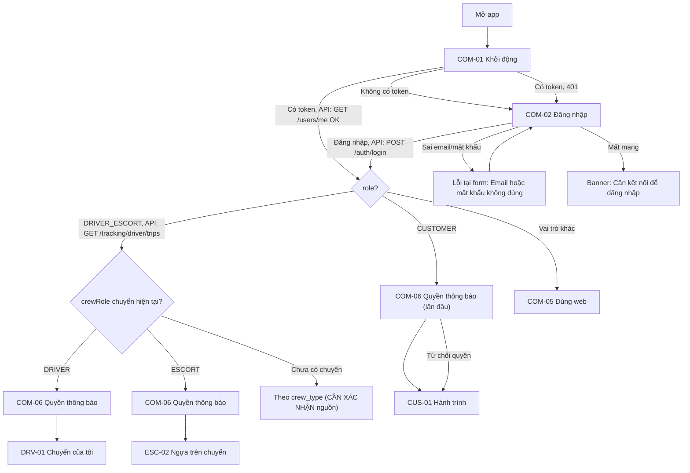

Đường chính: 2 chạm (Đăng nhập, Cho phép thông báo). Token lưu `expo-secure-store`.

### F-C2 Token hết hạn

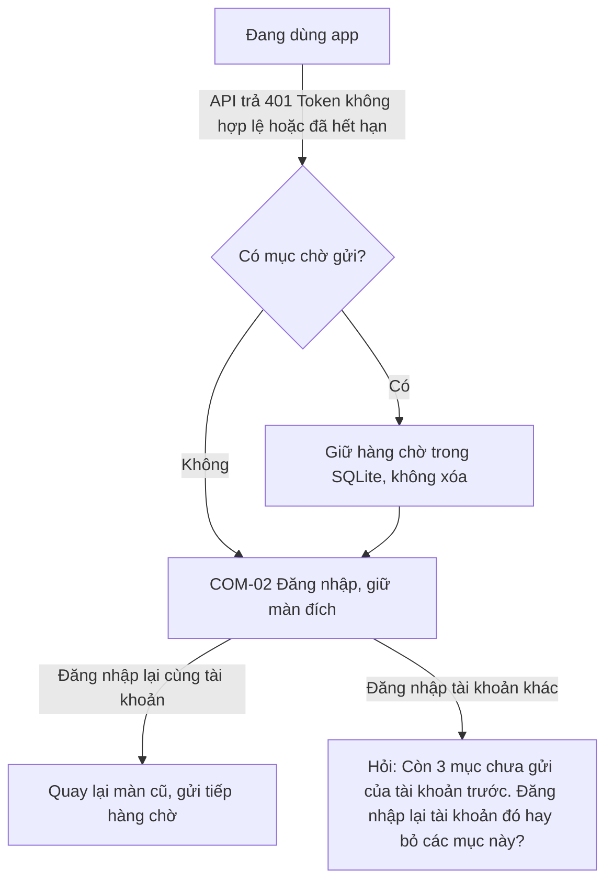

JWT 7 ngày, không có refresh (G5). Tài xế nên được nhắc đăng nhập lại trước chuyến nếu token còn < 24 giờ (**CẦN XÁC NHẬN** đọc `exp` trong JWT ở client).

### F-C3 Mất mạng giữa chừng

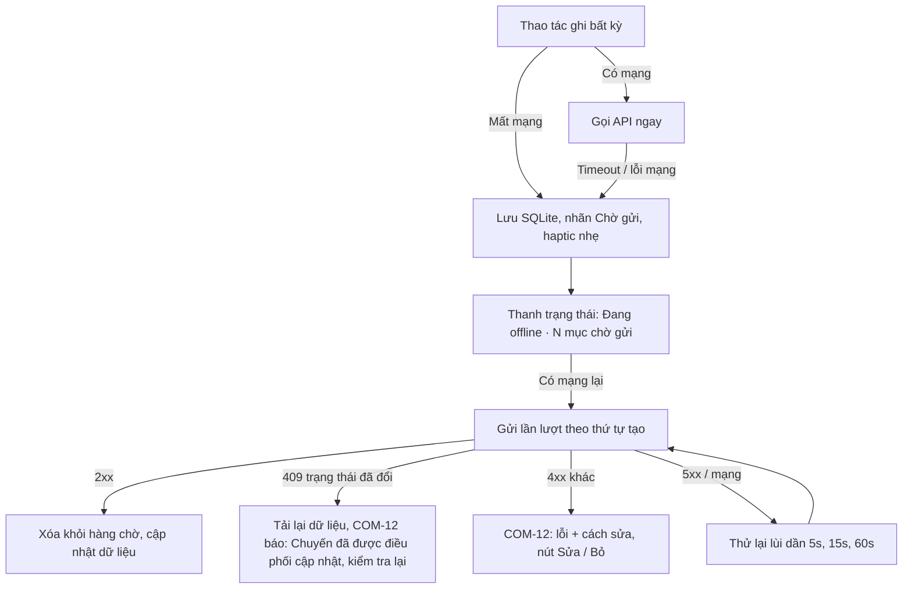

App bị tắt giữa chừng: hàng chờ nằm trong SQLite nên còn nguyên; khi mở lại, COM-01 gửi tiếp trước khi tải dữ liệu mới.

## 2. Khách hàng

### F-K1 Tạo hồ sơ ngựa

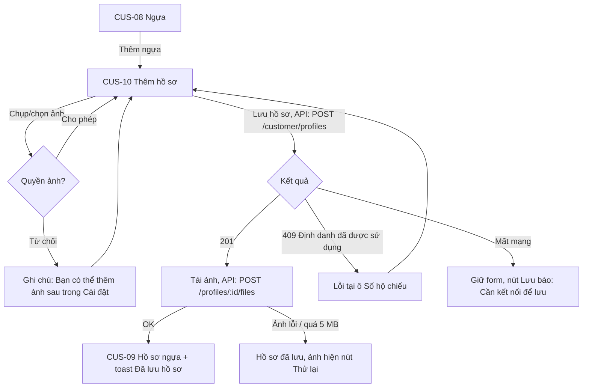

Đường chính: 3 chạm (Thêm ngựa, chọn ảnh, Lưu) + nhập form. Hồ sơ khách không vào hàng chờ offline vì cần kiểm tra trùng số hộ chiếu.

### F-K2 Gửi yêu cầu → báo giá → chấp nhận

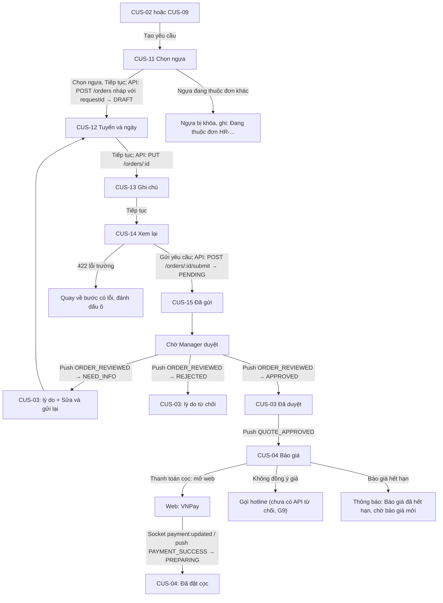

Đường chính tới khi gửi: 6 chạm (Tạo yêu cầu, chọn ngựa, 3 lần Tiếp tục, Gửi). Thoát giữa chừng: nháp đã lưu trên server từ bước 1, CUS-02 hiện đơn "Nháp" để làm tiếp. Trạng thái đơn bị đổi bởi người khác (VD manager đã duyệt khi khách đang sửa NEED_INFO): submit trả 409, app tải lại CUS-03.

### F-K3 Theo dõi chuyến từ push → hoàn thành

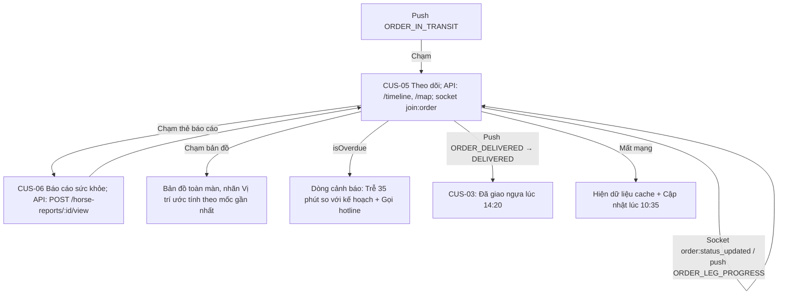

Đường chính: 1 chạm (mở push). Vị trí luôn ghi rõ là ước tính (quyết định G4).

## 3. Tài xế

### F-D1 Nhận chuyến → xem chi tiết

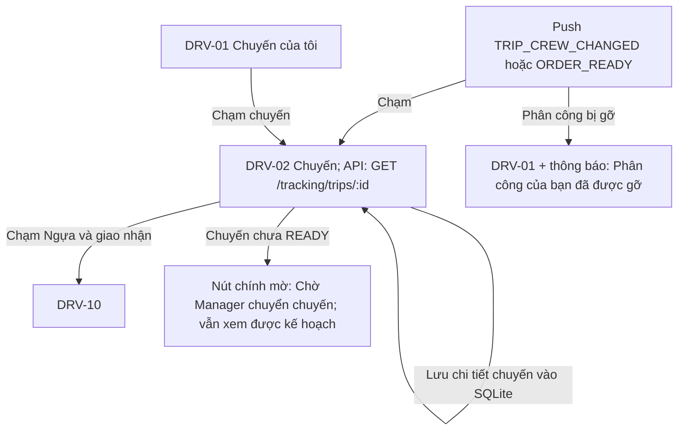

Đường chính: 1 chạm.

### F-D2 Checklist → bắt đầu chuyến (bật GPS nền)

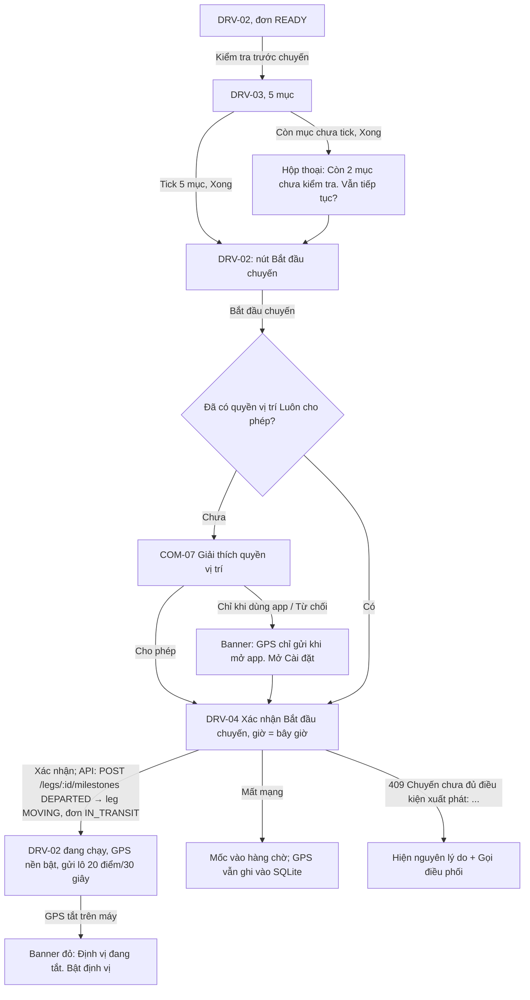

Đường chính nếu tick từng mục: **9 chạm** (Kiểm tra, 5 tick, Xong, Bắt đầu, Xác nhận). Thêm nút "Đã kiểm tra tất cả" ở cuối DRV-03 (1 chạm thay 5 tick) thì còn **5 chạm**. Checklist làm 1 lần mỗi chuyến nên chấp nhận được.

### F-D3 Cập nhật mốc từng điểm dừng đến khi giao

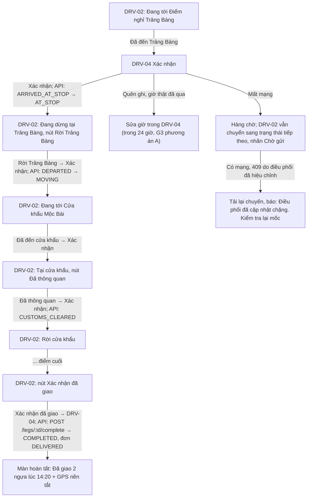

Mỗi điểm dừng: 2 chạm để đến (nút chính + Xác nhận), 2 chạm để rời. Đây là tác vụ thường xuyên nhất của tài xế. Rút gọn đề xuất: DRV-04 có nút "Xác nhận" cao 64pt ngay dưới ngón cái, và thời gian huỷ 5 giây ("Hoàn tác") thay cho hộp xác nhận ở mốc ít rủi ro (Đến/Rời điểm nghỉ) → 1 chạm. Giữ xác nhận 2 bước cho "Bắt đầu chuyến" và "Xác nhận đã giao". **Cần Long duyệt.**

Lưu ý: Long chọn ghi mốc theo **điểm dừng**. Backend hiện ghi mốc theo `legs` (chặng). Với chuyến mới chỉ có 1 chặng đại diện + `route_plan`, cần xác nhận cách backend gắn mốc ARRIVED_AT_STOP/DEPARTED vào từng điểm dừng (**CẦN XÁC NHẬN**, có thể cần thêm `stopIndex` vào API mốc).

### F-D4 Báo sự cố kèm ảnh khi không có mạng

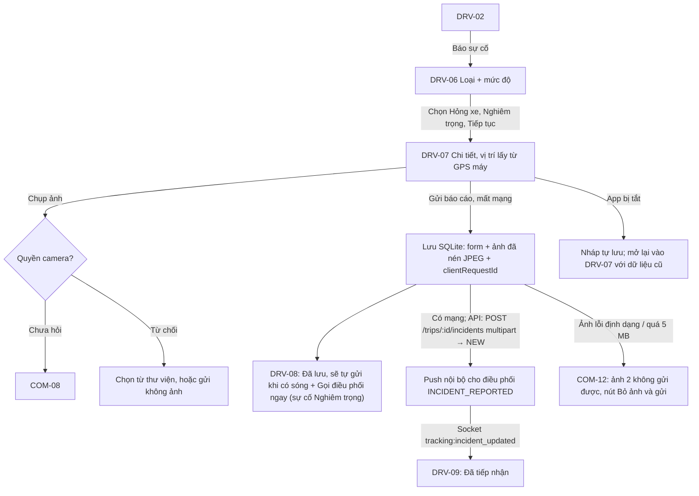

Đường chính: 6 chạm (Báo sự cố, loại, mức, Tiếp tục, chụp ảnh, Gửi) + mô tả ≥5 ký tự. Mô tả là trường nhập dài duy nhất của tài xế; đề xuất chip câu mẫu theo loại con (VD "Nổ lốp sau bên phải") để không phải gõ.

## 4. Hộ tống

### F-E1 Xem ngựa trên chuyến

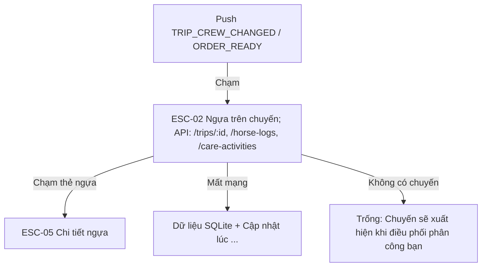

Đường chính: 1 chạm.

### F-E2 Ghi nhật ký chăm sóc / sức khỏe kèm ảnh

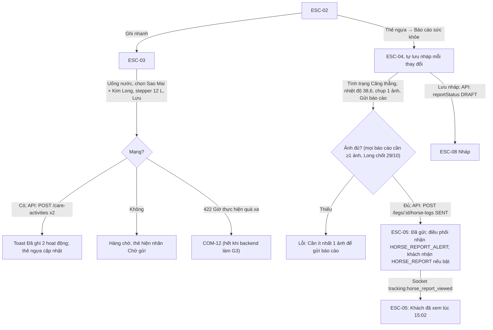

Ghi nhanh: **4 chạm** (Ghi nhanh, hoạt động, ngựa, Lưu) khi giữ lượng mặc định; ghi cho cả đoàn chỉ thêm 1 chạm "Chọn tất cả". Báo cáo sức khỏe: 5 chạm + ảnh.

### F-E3 Báo bất thường → ai nhận

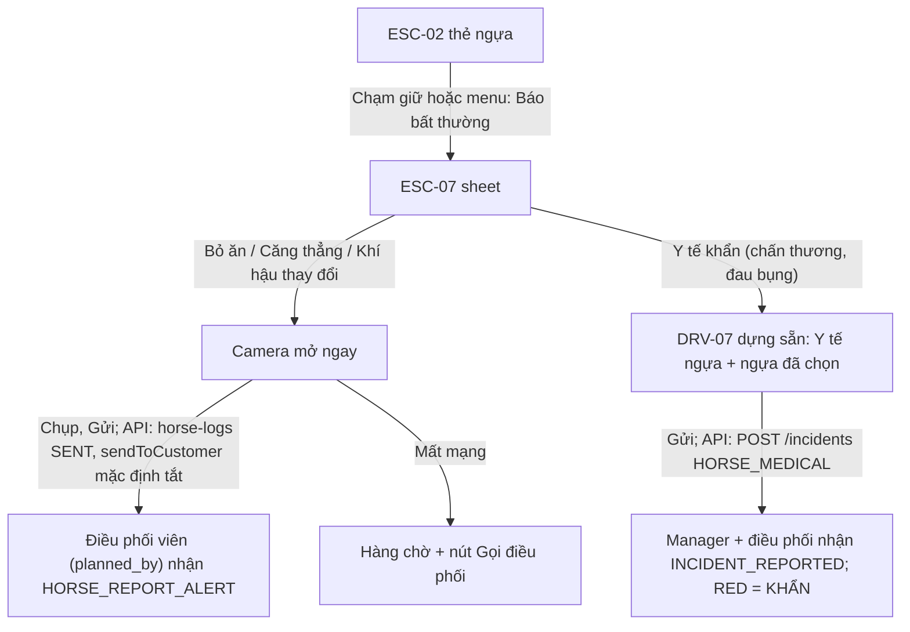

Đường chính: 4 chạm (giữ thẻ, chọn tình trạng, chụp, Gửi). Mục tiêu "2 chạm" của prompt không đạt được vì báo bất thường bắt buộc có ảnh (`HORSE_REPORT_PHOTO_REQUIRED_STATUSES`). Long chốt 29/10: giữ bắt buộc ảnh (4 chạm).

## 5. Thay đổi cần cập nhật vào 02-screens.md

1. Thêm **DRV-13 Hoàn tất chuyến** (màn sau "Xác nhận đã giao": tóm tắt, GPS đã tắt) — P0.
2. DRV-03 thêm nút "Đã kiểm tra tất cả".
3. DRV-04 thêm biến thể "Hoàn tác 5 giây" nếu Long duyệt.
4. ESC-07 ghi rõ 4 chạm, không phải 2.
5. COM-02 thêm biến thể "Còn mục chưa gửi của tài khoản trước" (F-C2).

## Tóm tắt

13 flow (3 chung, 3 khách hàng, 4 tài xế, 3 hộ tống), mỗi flow có nhánh mất mạng, quyền bị từ chối, 409 do người khác đổi trạng thái và app bị tắt. Tác vụ thường xuyên của tài xế (ghi mốc) là 2 chạm mỗi lần; của hộ tống (ghi chăm sóc) là 4 chạm. Phát hiện 1 điểm backend mới: ghi mốc theo điểm dừng có thể cần `stopIndex` trong API mốc.

## Quyết định của Long (29/10/2026)

1. Check-in điểm dừng dùng "Hoàn tác 5 giây": đường chính ghi mốc còn **1 chạm**. Thông quan và Đã giao giữ hộp xác nhận (2 chạm).
2. Báo bất thường giữ bắt buộc ảnh (4 chạm). Mọi báo cáo sức khỏe cũng bắt buộc ảnh.
3. Duyệt DRV-13 và các chỉnh sửa ở mục 5 (đã cập nhật vào 02-screens.md).
