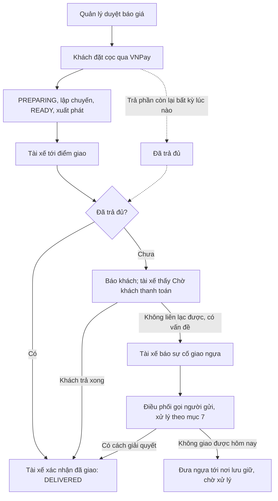
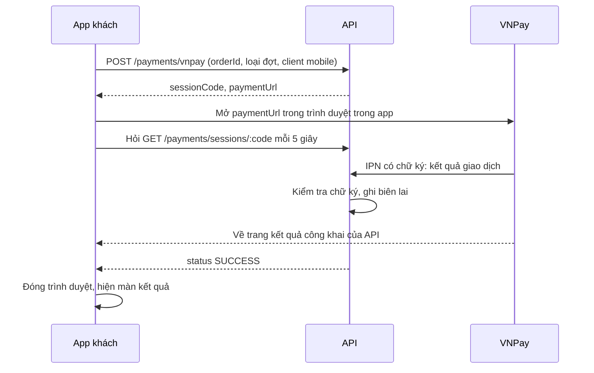
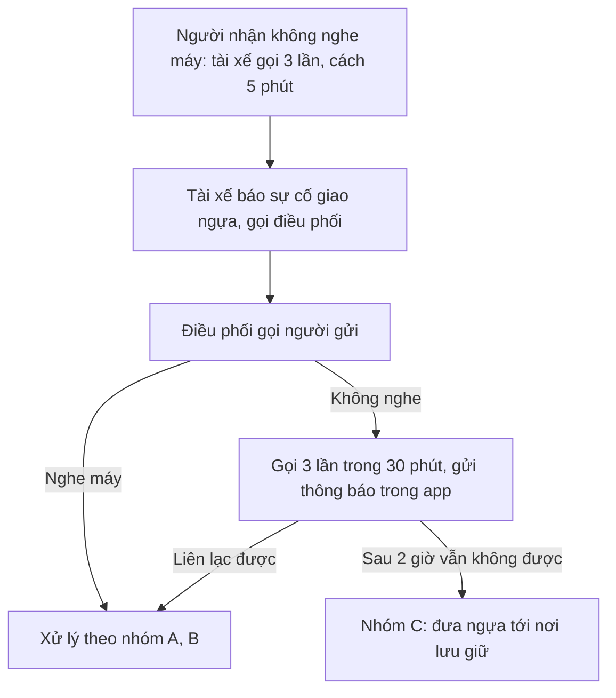

# 10 — Kế hoạch thanh toán VNPay trên mobile và xử lý khi giao ngựa

Ngày 06/11/2026. Trạng thái: **đã chốt hướng, chưa code. Sẽ bắt đầu ở phiên làm việc sau.**

## 0. Khi bắt đầu phiên sau

1. Đọc [00-context.md](00-context.md), rồi đọc file này. Làm trên nhánh `long`.
2. Chốt 4 câu ở mục 11. Mỗi câu đã có đề xuất, chỉ cần xác nhận.
3. Làm lần lượt theo các giai đoạn ở mục 9. Xong giai đoạn nào thì đánh dấu vào đó.
4. Chỉ test trên DB dùng một lần (cách dựng ở [09-test-va-sua-loi.md](09-test-va-sua-loi.md) mục 2). Cổng 3000 có thể đang là API của Long trỏ vào DB chung, nên API thử chạy cổng 3100.

**Các quyết định đã chốt:**

| Nội dung | Quyết định |
| --- | --- |
| Cổng thanh toán | VNPay Sandbox |
| Đợt 1 | Đặt cọc sau khi quản lý duyệt báo giá. Cọc xong hệ thống bắt đầu vận hành |
| Đợt 2 | Khách trả phần còn lại bất kỳ lúc nào sau khi cọc, giống web |
| Điều kiện giao | Chưa trả đủ thì tài xế phải đợi, trả xong mới xác nhận được đã giao |
| Người nhận không nghe máy | Tài xế báo điều phối, điều phối gọi người gửi; các trường hợp ở mục 7 |

Thay đổi so với quyết định cũ: 00-context và 02-screens ghi "thanh toán chỉ xem trạng thái, mở web". Phải sửa hai file này khi triển khai.

## 1. Luồng tổng thể

## 2. Hiện trạng đã đọc trong code

| Nội dung | Thực tế | Nguồn |
| --- | --- | --- |
| Tính tiền, chuyển `PREPARING`, biên lai, thông báo | Đã có, dùng lại được | `payments.service.ts` |
| Tạo link VNPay, kiểm tra chữ ký, nhận IPN | Đã có | `vnpay.ts`, `POST /payments/vnpay`, `GET /payments/vnpay/ipn` |
| Web thanh toán | Đang dùng **mô phỏng**. Trang VNPay có nhưng không nút nào dẫn tới | `CustomerQuote.tsx:266`, `VnpayCheckout.tsx` |
| Trang kết quả VNPay trên web | Cần đăng nhập để đọc phiên, nên trình duyệt mở từ mobile không dùng được | `VnpayCheckout.tsx:11` |
| Chặn giao khi chưa trả đủ | Chưa có | `tracking.service.ts:460` |
| Quản lý ghi nhận khoản thu tay | Đã có | `POST /manager/quotes/:id/receipts` |
| Loại sự cố | Chỉ có 3: hỏng xe, tắc đường, y tế ngựa | `incident.constants.ts` |
| App khai báo scheme | Chưa có trong `app.json` | `apps/mobile/app.json` |

**Lỗi cần sửa khi làm:**

- Mỗi lần bấm thanh toán tạo một phiên mới. Trả cả hai phiên qua VNPay thì phiên sau bị từ chối vì sai số tiền, trong khi tiền đã bị trừ và không có biên lai.
- `POST /payments/sessions/:code/complete` cho khách tự đánh dấu đã trả. Nếu còn mở thì khách có thể lách quy tắc giao hàng, nên phải tắt khi dùng VNPay.

## 3. Chuẩn bị cho VNPay Sandbox

**Long cần làm, Claude không làm thay được:**

1. Đăng ký tại https://sandbox.vnpayment.vn/devreg/ để nhận `TmnCode` và `HashSecret`.
2. Đưa vào `.env` trên máy, không gửi qua chat và không commit:
   - `VNPAY_TMN_CODE`
   - `VNPAY_HASH_SECRET`
   - `VNPAY_RETURN_URL`
3. Đăng ký IPN URL với VNPay: `https://<địa chỉ công khai>/api/v1/payments/vnpay/ipn`.

**Địa chỉ công khai cho API:** VNPay phải gọi được vào API thì tiền mới được ghi nhận. Khi phát triển có thể dùng đường hầm như `cloudflared` hoặc `ngrok`, nhưng mỗi lần đổi địa chỉ phải đăng ký lại IPN. Cần một địa chỉ cố định nếu demo nhiều lần (câu 1, mục 11).

Tài liệu đã có: `apps/api/VNPAY-SANDBOX.md`. Khi bắt đầu nên đọc lại tài liệu VNPay để kiểm tra thông tin thẻ thử và IPN còn đúng.

## 4. Cách thanh toán chạy trên mobile

- **Trình duyệt:** dùng `expo-web-browser` (cần cài thêm, chạy được trên Expo Go). Không dùng WebView vì dễ lỗi khi chuyển sang app ngân hàng.
- **Trang kết quả mới:** API thêm `GET /payments/vnpay/mobile-return`, không cần đăng nhập, không lộ thông tin, chỉ ghi "Đã nhận kết quả, hãy quay lại ứng dụng" và có nút mở lại app. Link VNPay của mobile dùng địa chỉ này.
- **Nguồn sự thật duy nhất là IPN.** Không tin tham số trên trình duyệt.
- **Phiên còn hạn 15 phút:** thoát app giữa chừng thì lưu mã phiên, mở lại quay về màn chờ. Chưa có kết quả sau khi hết hạn: không báo thất bại, hiện mã giao dịch và số hotline.
- **Đã trừ tiền mà IPN không về:** thêm tra cứu giao dịch chủ động với VNPay (`querydr`) khi phiên treo quá vài phút. Cần kiểm tra lại tài liệu VNPay khi làm.
- **Phương thức:** khách chọn ngay trên trang VNPay, app không cần màn chọn.

**Màn báo giá CUS-04:**

| Đơn | Tiền | Nút chính | Dòng phụ |
| --- | --- | --- | --- |
| `APPROVED`, báo giá còn hạn | `paid < deposit` | Đặt cọc X ₫ | Hạn báo giá |
| `APPROVED`, báo giá hết hạn | `paid < deposit` | Không có | Báo giá đã hết hạn, liên hệ quản lý |
| `PREPARING`, `READY`, `IN_TRANSIT` | `deposit ≤ paid < total` | Thanh toán Y ₫ | Cần trả đủ trước khi tài xế giao ngựa |
| `IN_TRANSIT`, xe đã tới điểm giao | `paid < total` | Thanh toán Y ₫ | Xe đã tới. Tài xế đang đợi bạn thanh toán để giao ngựa |
| Bất kỳ | `paid >= total` | Không có | Đã thanh toán đủ |

Viết logic thành hàm thuần `paymentAction(order, quote, legs, now)` trong `live-domain.ts`, thay cho `quoteExpiredForPayment`, kèm unit test.

## 5. Màn tài xế khi tới điểm giao

| Tình huống | Hiển thị |
| --- | --- |
| Đã trả đủ | Nút "Đã giao ngựa an toàn" như hiện tại |
| Chưa trả đủ | Nút khóa "Chờ khách thanh toán", nút "Kiểm tra lại", gọi người nhận, gọi điều phối, nút "Báo sự cố giao ngựa" |
| Khách vừa trả | Nút mở lại ở lần tải kế tiếp; app hỏi lại mỗi 15 giây khi đang đợi |
| Điều phối đã mở ngoại lệ | Nút mở, kèm dòng "Điều phối cho phép giao: <lý do>" |

Tài xế và hộ tống **chỉ thấy đã trả đủ hay chưa, không thấy số tiền**.

## 6. Các điểm kỹ thuật phải cẩn thận

1. **Mất mạng:** máy chủ quyết định. Khi bị từ chối, mục trong hàng chờ báo "Khách chưa thanh toán đủ" và gửi lại được sau khi khách trả.
2. **Mã lỗi riêng:** dùng HTTP `402`. Không dùng `409`, vì hàng chờ đang coi `409` sau khi mất phản hồi là "mốc đã đến nơi", và mốc giao sẽ bị bỏ dù chưa giao (`isReplayConflict`).
3. **Không báo giao sớm trên máy:** hiện bấm giao là app tắt GPS, báo "Đã giao" và đổi trạng thái ngay (`record` trong `TripScreens.tsx`, `applyPending`). Phải chờ máy chủ nhận.
4. **Đơn không có báo giá duyệt:** dữ liệu cũ có thể không có báo giá. Chỉ chặn khi có báo giá `APPROVED` và `paid < total`.
5. **Xác nhận chậm:** tiền đã trừ nhưng IPN chưa về thì tài xế vẫn thấy chưa trả. Màn khách phải hiện "Đang chờ xác nhận".
6. **Chuyến đang chạy khi triển khai:** chuyến chưa trả đủ sẽ bị chặn ở bước giao ngay. Kiểm tra các chuyến `IN_TRANSIT` trước khi đưa lên.
7. **DB chung:** các migration của kế hoạch này chỉ chạy trên DB chung khi Long đồng ý.

## 7. Tình huống phát sinh khi giao ngựa

**Vai trò:** người gửi là chủ tài khoản khách hàng và là người trả tiền. Người nhận là người nhận ngựa tại điểm giao, có thể không có app. Điều phối xử lý vận hành. Quản lý quyết định về tiền.

**Các con số dưới đây là đề xuất, cần xác nhận.** Nguyên tắc chung: **an toàn của ngựa luôn đứng trước tiền và lịch trình.** Mọi quyết định ghi vào sự cố, kèm người quyết định và giờ.

### Nhóm A. Người nhận không có mặt, liên lạc được người gửi

| # | Trường hợp | Điều phối xử lý | Kết quả |
| --- | --- | --- | --- |
| A1 | Người nhận đang đến, trễ dưới 1 giờ | Hẹn giờ, gửi hướng xử lý kèm thời gian chờ cho tài xế | Tài xế đợi, giao bình thường |
| A2 | Người nhận trễ trên 1 giờ | Hộ tống chăm sóc ngựa trong lúc đợi; báo trước phí chờ nếu có | Giao khi người nhận tới, ghi phí phát sinh |
| A3 | Người nhận đổi số điện thoại | Xin số mới, cập nhật đơn, báo tài xế | Tài xế gọi số mới |
| A4 | Người gửi cử người khác nhận thay | Lấy tên, số điện thoại; tài xế đối chiếu giấy tờ, chụp ảnh lúc bàn giao | Giao, ghi người nhận thực tế |
| A5 | Người gửi tự tới nhận | Xác nhận danh tính, báo tài xế | Giao, ghi người gửi nhận |
| A6 | Muốn đổi sang địa điểm gần | Kiểm tra đường đi, thời gian tổ lái, phúc lợi ngựa; báo phụ phí | Đồng ý thì đổi điểm giao, quản lý thu phụ phí |
| A7 | Muốn đổi địa điểm xa | Quản lý báo giá bổ sung trước khi đi | Không đồng ý giá thì xử lý như A8 |
| A8 | Muốn giao lại ngày khác | Tìm nơi lưu giữ gần nhất đủ điều kiện, báo phí lưu và phí giao lại | Đưa ngựa tới nơi lưu, hẹn lại (nhóm C) |
| A9 | Người gửi không biết vì sao người nhận vắng | Cho người gửi 30 phút để liên hệ, điều phối gọi lại | Về lại A1 đến A8 |
| A10 | Người gửi muốn đưa ngựa về điểm đón | Báo chi phí chiều về; quản lý lập báo giá mới | Khách đồng ý thì tạo đơn mới. Đơn cũ vẫn tính tiền đã chạy |

### Nhóm B. Vấn đề về tiền

| # | Trường hợp | Xử lý | Kết quả |
| --- | --- | --- | --- |
| B1 | Khách đồng ý trả ngay | Nhắc mở app, trả qua VNPay | Tài xế giao bình thường |
| B2 | VNPay lỗi hoặc khách không dùng được | Hướng dẫn chuyển khoản vào tài khoản công ty; quản lý đối soát rồi ghi khoản thu | Đủ tiền thì tài xế giao được |
| B3 | Người nhận trả tiền mặt tại chỗ | **Tài xế không tự xác nhận được.** Tài xế chụp biên nhận, báo điều phối; quản lý ghi khoản thu loại tiền mặt | Giao, tài xế nộp tiền về sau và có đối soát |
| B4 | Khách báo đã trả, hệ thống chưa thấy | Xin mã giao dịch, tra `querydr`; có tiền mà thiếu biên lai thì quản lý ghi tay, kiểm tra không ghi trùng | Giao khi xác nhận có tiền |
| B5 | Khách xin trả sau, là khách tin cậy | **Quản lý duyệt**, ghi hạn trả | Điều phối mở ngoại lệ, giao, ghi công nợ |
| B6 | Khách xin trả sau, chưa đủ tin cậy | Quản lý từ chối hoặc yêu cầu trả một phần | Về nhóm C nếu không trả |
| B7 | Chỉ trả được một phần | Quản lý ghi nhận và quyết định như B5 hoặc B6 | Giao nếu quản lý duyệt phần nợ |
| B8 | Khách cãi về số tiền | Quản lý đối chiếu báo giá đã duyệt, xử lý ngay trong ngày | Điều chỉnh rồi trả, hoặc về nhóm C |
| B9 | Khách từ chối trả | Quản lý xử lý, lập biên bản, không tự ý thả ngựa cho người chưa xác minh | Nhóm C. Việc giữ ngựa cần đối chiếu điều khoản hợp đồng và tư vấn pháp lý |

### Nhóm C. Không liên lạc được hoặc không giao được trong ngày

| # | Trường hợp | Xử lý | Kết quả |
| --- | --- | --- | --- |
| C1 | Không liên lạc được cả hai sau 2 giờ | Quản lý được báo. Đưa ngựa tới nơi lưu giữ gần nhất | Trạng thái "Đang lưu giữ", thông báo cho khách |
| C2 | Đang lưu giữ, khách liên lạc lại | Thống nhất lịch, thu đủ tiền và phí lưu | Lập chuyến giao lại |
| C3 | Quá 48 giờ vẫn không liên lạc được | Quản lý gửi thông báo chính thức, tiếp tục chăm sóc và tính phí | Xử lý theo hợp đồng |
| C4 | Không có nơi lưu giữ phù hợp gần đó | Điều phối tìm chuồng thay thế, hoặc đưa về cơ sở công ty | Chọn phương án an toàn nhất cho ngựa |
| C5 | Giờ làm của tổ lái sắp hết | Đổi tổ lái hoặc cho nghỉ, không ép chạy | Ghi đổi nhân sự |
| C6 | Xe và tổ lái bị trễ chuyến sau | Điều phối sắp xếp lại chuyến sau, báo khách của chuyến đó | Chi phí trễ ghi vào đơn gây trễ nếu có quy định |

### Nhóm D. Vấn đề tại điểm giao

| # | Trường hợp | Xử lý | Kết quả |
| --- | --- | --- | --- |
| D1 | Ngựa có dấu hiệu bệnh trong lúc đợi | Báo sự cố y tế khẩn. Gọi thú y, ưu tiên hơn mọi việc khác | Chi phí xử lý sau, không để ngựa chờ vì chuyện tiền |
| D2 | Trời nguy hiểm, xe quá nóng | Di chuyển ngựa tới chỗ an toàn ngay, báo điều phối | Ghi lại, giao khi an toàn |
| D3 | Người nhận từ chối vì ngựa bị thương | Chụp ảnh, lập biên bản, báo sự cố, mời thú y; quản lý làm việc với khách | Không xác nhận giao tới khi có kết luận |
| D4 | Giao nhầm hoặc thiếu ngựa | Đối chiếu số hộ chiếu, dừng bàn giao | Chỉ giao đúng ngựa |
| D5 | Người nhận không đúng tên, không có giấy tờ | Không giao. Điều phối xác minh với người gửi | Xử lý như A4 nếu người gửi xác nhận |
| D6 | Địa điểm đóng cửa, không có chuồng | Hỏi người gửi địa điểm khác | Xử lý như A6 hoặc A8 |
| D7 | Thiếu giấy tờ kiểm dịch khi giao | Chuyên viên kiểm tra; không giao nếu vi phạm quy định | Lưu giữ tới khi đủ giấy tờ |
| D8 | Xe không vào được điểm giao | Hẹn điểm bàn giao gần, có người nhận đi cùng | Ghi điểm giao thực tế |
| D9 | Khách đòi hủy đơn khi xe đã tới | Quản lý xử lý theo chính sách hủy; cọc không tự hoàn | Cần chính sách, xem câu 3 |
| D10 | Tài xế mất sóng tại điểm giao | Gọi điện báo điều phối; mốc gửi bù khi có sóng | Quản lý ghi tiền; ghi bù trong 24 giờ |

### Cần thêm gì vào hệ thống

Làm **vừa đủ để lưu vết và xử lý**. Giai đoạn đầu dùng lại luồng sự cố có sẵn, vì đã có phản hồi của điều phối, thời gian chờ, và đã hiện ở tab Sự cố của tổ lái.

1. Thêm loại sự cố **"Giao ngựa"** `DELIVERY_ISSUE`, loại con: không liên lạc được người nhận, khách chưa thanh toán, người nhận từ chối, địa điểm có vấn đề, khác.
2. Thêm **"Mở ngoại lệ giao ngựa"**: ghi lý do, người duyệt, giờ. Tài xế vẫn tự bấm giao nên giờ giao vẫn đúng thực tế. Đơn còn nợ vẫn hiện ở công nợ của quản lý.
3. Quyền: nợ tiền (B5, B7) chỉ **quản lý** duyệt. Điều phối mở ngoại lệ khi quản lý đã duyệt. `PATCH /legs/:id/correct` phải kiểm tra cùng quy tắc, hoặc yêu cầu ngoại lệ, để không lách được.
4. Ghi **người nhận thực tế** và ảnh bàn giao khi giao qua A4, A5.
5. **Trạng thái "Đang lưu giữ", chuyến giao lại, phí phát sinh** là phần lớn. Giai đoạn đầu ghi tay vào sự cố và khoản thu; làm thành tính năng ở giai đoạn sau nếu cần.

## 8. Việc cần làm theo khu vực

**Backend:** chặn `DELIVERED` và trả `402`; `paymentCleared` trong chi tiết chuyến; thông báo khi xe tới mà chưa đủ tiền và khi đã trả đủ; lấy lại phiên `PENDING`; tắt thanh toán mô phỏng khi dùng VNPay; trang `mobile-return`; loại sự cố mới; ngoại lệ giao ngựa; `expires_at` trong danh sách đơn.

**Web:** khách thanh toán bằng VNPay thay cho mô phỏng; tài xế có trạng thái chờ và xử lý `402`; điều phối xử lý sự cố giao ngựa; quản lý duyệt nợ.

**Mobile khách hàng:** `paymentAction`, CUS-04, CUS-17 chờ thanh toán, CUS-18 kết quả; thẻ đợt 2 và thẻ khẩn khi xe đã tới; `expo-web-browser`.

**Mobile tài xế, hộ tống:** chặn nút giao theo `paymentCleared`, sửa `record`, hàng chờ xử lý `402`, báo sự cố giao ngựa.

**Tài liệu:** 00-context, 01-data-inventory, 02-screens, 03-user-flows, mockup các màn mới, changelog.

## 9. Thứ tự làm

Mỗi giai đoạn có thể commit riêng và test được.

- [ ] **Giai đoạn 0. Chuẩn bị:** chốt mục 11, có khóa VNPay và địa chỉ công khai.
- [ ] **Giai đoạn 1. VNPay trên mobile:** phiên không trùng, `mobile-return`, CUS-04, CUS-17, CUS-18. Xong là đặt cọc và trả phần còn lại được bằng thẻ thử trên iPhone.
- [ ] **Giai đoạn 2. Web đồng bộ:** web dùng VNPay, tắt mô phỏng.
- [ ] **Giai đoạn 3. Điều kiện giao:** chặn `DELIVERED`, `paymentCleared`, màn tài xế trên mobile và web, thông báo, hàng chờ `402`.
- [ ] **Giai đoạn 4. Sự cố giao ngựa:** loại sự cố mới, ngoại lệ, quyền quản lý và điều phối, người nhận thực tế.
- [ ] **Giai đoạn 5. Rà soát và kiểm thử:** toàn bộ mục 10, cập nhật tài liệu, kiểm tra các chuyến đang chạy, chạy migration trên DB chung khi Long đồng ý.

Làm giai đoạn 2 trước 3 vì nếu web còn mô phỏng thì khách có thể tự đánh dấu đã trả để tài xế giao được.

## 10. Kiểm thử

| Nhóm | Ca |
| --- | --- |
| VNPay | Đặt cọc và trả phần còn lại bằng thẻ thử; hủy trên trang VNPay; thẻ thử thất bại; IPN sai chữ ký; IPN gửi hai lần |
| Phiên | Bấm hai lần chỉ một phiên; phiên hết 15 phút; tắt app rồi mở lại; xác nhận về muộn |
| Điều kiện giao | Tới nơi chưa trả: API từ chối, nút khóa, khách có thông báo; trả xong giao được; quản lý ghi khoản thu thì giao được |
| Không lách được | Khách không tự xác nhận được; `correct` không bỏ qua được quy tắc; tài xế không tự mở ngoại lệ |
| Mất mạng | Tài xế bấm giao khi offline bị từ chối đúng lý do; GPS chưa tắt; khách trả xong gửi lại được |
| Sự cố giao ngựa | Tài xế báo, điều phối phản hồi, mở ngoại lệ, tài xế giao; các ca A4, B3, B5, C1, D1 |
| Phân quyền | Tổ lái không thấy số tiền; khách khác không xem được phiên; điều phối không tự duyệt nợ |
| Thiết bị | iPhone và Android, có chuyển sang app ngân hàng rồi quay lại nếu thử được |

Bổ sung các ca API vào `apps/mobile/scripts/e2e-api.mts`, chạy trên DB dùng một lần.

## 11. Câu hỏi chốt khi bắt đầu

1. **Địa chỉ công khai của API:** dùng đường hầm tạm khi phát triển, hay đã có máy chủ triển khai? Đề xuất: đường hầm cho giai đoạn phát triển.
2. **Web đổi sang VNPay luôn?** Đề xuất: có, vì để mô phỏng thì khách có thể lách quy tắc giao hàng.
3. **Con số và chính sách ở mục 7:** gọi 3 lần, chờ 2 giờ, quá 48 giờ, phí chờ, phí lưu, chính sách hủy khi xe đã tới. Đề xuất: dùng con số ở mục 7, phí và hủy do quản lý quyết định từng ca ở giai đoạn đầu.
4. **Phạm vi giai đoạn đầu của mục 7:** đề xuất chỉ làm 5 mục ở "Cần thêm gì vào hệ thống", trong đó mục 5 ghi tay.

## 12. Ngoài phạm vi

Thanh toán tiền thật, hoàn tiền, xuất hóa đơn, trả góp, tính năng đổi báo giá sau khi đã cọc (ghi tay ở giai đoạn đầu), push (app vẫn làm mới 30 giây một lần).
